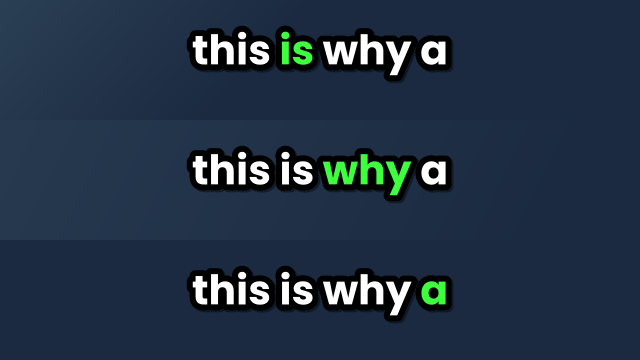

# Tech Bench Auto-Captioner

A free, local, fast alternative to online auto-caption tools. Drop in your videos and get
**karaoke-style captions** burned into a copy: white text, a thick black outline, and the
word currently being spoken highlighted in a colour of your choice (green by default).
Fix any mistakes in a built-in editor before the video is rendered.

It runs on your own PC using [faster-whisper](https://github.com/SYSTRAN/faster-whisper) for
transcription and [ffmpeg](https://ffmpeg.org/) for rendering, so there's no upload, no queue
and no export wait. It also saves a standard `.srt` file you can upload straight to YouTube.

> **Status:** early version, built for Windows 10/11 (64-bit). Bug reports welcome.



*Example frames from the caption style (rendered here with the Poppins font).*

## Features

- Simple window (no command line needed), with batch processing and a progress bar
- **Nothing to install by hand:** ffmpeg and the speech model are downloaded for you the first time
- **Caption editor:** review the transcript, fix text, delete lines, find-and-replace
- **Saved transcripts:** restyle or re-render without re-running transcription
- Highlighted-word karaoke captions with outline and shadow
- Choose font, size, highlight colour, words on screen and ALL CAPS
- Uses your GPU's video encoder (NVENC / QSV / AMF) when available, and falls back to the CPU
- Handles 10-bit and HDR phone/camera footage, and vertical (Shorts/Reels) video
- Custom vocabulary prompt so tech terms (HDMI, NVMe, Ryzen...) are spelled correctly
- Never touches your original video: output is saved as `yourvideo_captioned.mp4`

## Get it

### Option 1 - Windows app (no Python needed)

1. Download `TechBenchCaptions-...-windows.zip` from the [Releases](../../releases) page.
2. Unzip it anywhere and run `TechBenchCaptions.exe`.

Windows may show a "Windows protected your PC" (SmartScreen) or antivirus warning because the app
isn't code-signed yet. Choose **More info -> Run anyway** if you trust the download.

### Option 2 - Run from source

Requires [Python 3.9+](https://www.python.org/downloads/) (tick "Add Python to PATH").

```
git clone https://github.com/YOUR-USERNAME/techbench-captions.git
cd techbench-captions
pip install -r requirements.txt
python techbench_captions.pyw
```

## First run: what gets downloaded

The first time you render, the app shows **one prompt** listing what it needs, then downloads it:

| What | Why | Size (approx.) | From |
| --- | --- | --- | --- |
| ffmpeg | Draws the captions into your video | ~100 MB | [gyan.dev](https://www.gyan.dev/ffmpeg/builds/) (checksum-verified) |
| Speech model | Turns speech into text | ~485 MB for `small.en` | [Hugging Face](https://huggingface.co/Systran) |

Both are saved in `%LOCALAPPDATA%\TechBenchCaptions` and only downloaded once. Nothing else is
uploaded or downloaded, and your videos never leave your PC. If you already have a working, modern
ffmpeg installed, it's used instead. To remove everything, delete that folder.

If you only want the `.srt` file, untick **Burn captions** and ffmpeg isn't needed at all.

## Use

1. Click **Add videos...** and choose one or more files.
2. Pick your caption style.
3. Click **Start**. The video is transcribed first.
4. The **caption editor** opens (if enabled). Fix any mistakes, then click **Done - continue**.
5. The captions are rendered into `video_captioned.mp4`.

Outputs are saved next to each video: `video.srt`, `video.captions.json` (the saved transcript)
and, if enabled, `video_captioned.mp4`.

### The caption editor

- Click a line, edit the text in the box, and press **Enter** to save it and move to the next line.
- **Find and replace** fixes a misheard word everywhere at once (for example `nvidia` -> `NVIDIA`).
- **Delete line** removes junk captions. **Open video to check** opens the video in your player.
- Words you don't change keep their original timing. If you add or replace words, their timing is
  spread across the time the old words took.
- **Skip this video** closes the editor without rendering that video.

### Restyling without re-transcribing

Leave **Reuse saved transcript** ticked. Next time you run the same video, the app loads
`video.captions.json` instead of transcribing again, so changing the font, colour or size and
re-rendering takes only as long as the encode. Delete the `.captions.json` file (or untick the
option) to transcribe from scratch, for example after switching to a different model.

### Settings

| Setting | Notes |
| --- | --- |
| Model | `small.en` is a good balance. `medium.en` / `large-v3` are more accurate but slower and a bigger first download. |
| Words on screen | 3-4 suits Shorts; 5-6 suits normal videos. |
| Font | Type any font installed on your PC (name must match exactly). |
| Review and edit captions | Opens the editor after transcription. Untick for a fully automatic run. |
| Device | `auto` uses the GPU for transcription only if NVIDIA's CUDA libraries are installed, otherwise the CPU. |
| ffmpeg location | Leave empty to use the automatic one; use Browse to choose your own. |

To improve spelling of your own jargon, edit `JARGON_PROMPT` near the top of `techbench_captions.pyw`.

### A note on speed (GPU)

*Rendering* uses your graphics card's video encoder (NVENC on NVIDIA) with no extra setup.
*Transcription* on the GPU needs NVIDIA's CUDA libraries (cuBLAS and cuDNN), which are very large
and **not** included in the Windows app, so the app transcribes on the CPU by default. That works
fine, just slower than a GPU. If you run from source and have the CUDA libraries installed, the
GPU is used automatically.

## Building the Windows app yourself

On a Windows PC with Python installed, double-click `build_exe.bat` (or run it from a terminal).
It builds in a clean virtual environment and produces `dist\TechBenchCaptions\TechBenchCaptions.exe`
plus `dist\TechBenchCaptions-windows.zip`.

To have GitHub build it for you: push a version tag (for example `git tag v1.1.0` then
`git push --tags`). The **Build Windows app** workflow runs, and attaches the zip to the Release.
You can also run it by hand from the repository's **Actions** tab.

## Troubleshooting

**The app doesn't start / a DLL error appears** - install the
[Microsoft Visual C++ Redistributable (x64)](https://learn.microsoft.com/cpp/windows/latest-supported-vc-redist)
and try again. Unexpected errors are also written to `%LOCALAPPDATA%\TechBenchCaptions\crash.log`.

**`open() got an unexpected keyword argument 'metadata_errors'`** - a too-new PyAV (19+) clashing
with faster-whisper. Fixed in 1.1.0. If you run from source, run `pip install "av<19"`.

**The ffmpeg or model download fails** - check your internet connection and press Start again; it
picks up where it can. Corporate networks or VPNs sometimes block `gyan.dev` or `huggingface.co`.
As a workaround, install ffmpeg yourself and choose it with **Browse...**.

**`Unable to parse option value "-1" as pixel format`** - your ffmpeg is too old to decode the
video (often H.265/HEVC). The app now detects this and downloads a current one instead. If you run
from source, run `Get-Command ffmpeg -All | Select-Object Source` in PowerShell to see every ffmpeg
on your PATH; a stray old `ffmpeg.exe` can hide the new one.

**`10 bit encode not supported` / `_captioned.mp4` won't open** - fixed in 1.1.0. Older versions
tried to encode 10-bit footage (common from phones and cameras) on the GPU's H.264 encoder, which
only supports 8-bit, so no video was written.

**`A module that was compiled using NumPy 1.x cannot be run in NumPy 2.x`** (source install only) -
an older PyTorch install is clashing with NumPy 2. Run `pip install "numpy<2"` or upgrade torch, or
use a virtual environment.

**Wrong font** - the font name must match an installed font exactly. Try one from the dropdown.

## Third-party software and licences

This repository does not contain fonts, ffmpeg or the speech models. The app downloads ffmpeg from
[gyan.dev](https://www.gyan.dev/ffmpeg/builds/) (static GPLv3 builds of [FFmpeg](https://ffmpeg.org/);
its licence file is saved alongside it) and the models from Hugging Face. Fonts such as Arial Black
are referenced by name and must be installed on your system. faster-whisper and OpenAI's Whisper
models are MIT-licensed. The Windows app bundles Python and several open-source libraries under
their own licences.

## License

[MIT](LICENSE)
